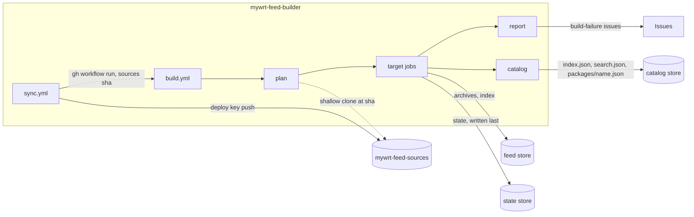

# mywrt-feed-builder

**English** | [中文](README_ZH.md)

Maintains the `mywrt` OpenWrt package feed:

1. **Sync**: fetches the upstream packages listed in `sources.toml`, applies
   `local-patches/`, and pushes the result to
   [mywrt-feed-sources](https://github.com/MyWRT/mywrt-feed-sources) as
   `<category>/<name>/`. That repository is usable directly as a
   `src-git` feed.
2. **Build**: compiles only the packages whose sources changed, with the
   ImmortalWrt SDK containers, and publishes them to the feed store at
   `<feed store>/packages-<version>/<arch>/mywrt/`.

Dependencies from the official feeds are compiled when needed but never
published; devices get them from the ImmortalWrt feeds.



## Files

| Path | Purpose |
|---|---|
| `sources.toml` | upstream repositories: one `[[package]]` per package (`name`, `category`, `repo`, optional `branch`, `path`) |
| `local-patches/feed/<name>/*.patch` | applied to the package directory during sync |
| `local-patches/source/<name>/*.patch` | copied to `<name>/patches/` for OpenWrt to apply to the upstream source |
| `targets.toml` | versions, architectures, extra `.config`, storage, retention, `epoch` |
| `templates/sources-README.md`, `templates/sources-README_ZH.md` | READMEs of the sources repository, English and Chinese (`${updated}` placeholder) |
| `scripts/sync_sources.py` | sync step |
| `scripts/feedctl.py` | build planning, feed state, retention, garbage collection, catalog |
| `docs/catalog.md` | format of the published metadata catalog (contract for web front ends) |
| `scripts/failure_issues.py` | opens, comments on and closes `build-failure` issues |
| `scripts/sdk-run.sh`, `sdk/entry.sh` | run the SDK container (`build` or `index`) |

## Sync

`sync.yml` runs daily, on manual dispatch, and on pushes that change
`sources.toml`, `local-patches/` or `templates/`. It aborts without touching the
sources repository if any clone fails, a package has no `Makefile`, names
collide, or a patch does not apply (for example because upstream already
contains the fix: delete the patch). When the generated tree differs, it commits
`Sync: <changed packages>` and, if packages changed, starts `build.yml` for that
commit.

The READMEs are rendered from `templates/sources-README.md` and
`templates/sources-README_ZH.md` with
[`string.Template`](https://docs.python.org/3/library/string.html#template-strings)
(`$$` for a literal `$`). `${updated}` is the time packages last changed, in UTC
(`2026-10-16 03:15 UTC`). Sync commits carry that time as their author date and
later syncs read it back, so a template-only change keeps the previous time and
an unchanged sync produces no commit.

## Build

`build.yml` runs when sync pushes a commit, when `targets.toml` changes, or
manually (`packages` forces rebuilds, `full_rebuild` rebuilds everything).
There is no scheduled build: state is compared against the sources, so any run
picks up whatever an earlier interrupted run missed. A red run means an
infrastructure problem (nothing or only part of the feed was published); re-run
it. Package failures do not fail the run: the feed is still published, the
package gets a warning annotation and a `Build failure: <name>` issue.

Each target has a state file `<state store>/packages-<version>/<arch>.json`
recording, per package, the fingerprint it was last built with and the outcome.
The fingerprint hashes `<category>/<name>/` (ignoring top-level `README*`,
`LICENSE*`, `LICENSES/`, `.gitignore`, and `.github/`) together with the build
recipe from `targets.toml`.

| Outcome | Feed | Next run |
|---|---|---|
| built | new archives indexed | rebuilt when the fingerprint changes |
| unsupported (arch excluded by `DEPENDS`) | old archives unindexed | rebuilt when the fingerprint changes |
| build failed (compile also retried once with `-j1 V=s`) | keeps the previous build; issue opened | **not retried** until the fingerprint changes or a manual run names it |
| download failed (3 attempts per run) | keeps the previous build | retried; after 3 failing runs treated as a build failure |

The `report` job opens one `Build failure: <name>` issue per package with the
failing targets, source commit and log tails, comments on it if it fails
again, and closes it once no target state marks the package as failed. Full logs
are kept as `logs-<version>-<arch>` artifacts for 30 days.

## Retention

The index lists only the newest build of each package. Older archives stay
downloadable while they were current within the last `retention.days` (30), and
the newest `retention.min_versions` (2) archives of every published package are
always kept. Archives of removed packages are kept for `retention.days`. Files in
the feed directory referenced by neither the state nor the index are deleted
after each publish, so expired archives are removed the next time the target
builds.

## Storage

All stores are rclone paths set in `[storage]` of `targets.toml`, using remotes
from the `RCLONE_CONFIG` secret, so any rclone backend works (R2, S3, Dropbox,
...).

| Store | Holds | Requirements |
|---|---|---|
| feed (`storage.feed`) | archives and signed indexes | large; served to devices over HTTP(S) **without redirects**: apk and opkg do not follow them, so Dropbox needs a proxy in front that streams files |
| state (`storage.state`) | one small JSON per target | durable; read by every run |
| catalog (`storage.catalog`) | package metadata for web front ends ([format](docs/catalog.md)) | regenerated from all states by the `catalog` job of every run and replaced with `rclone sync`, so it must not contain the feed or state store, nor lie inside the state store |

A publish writes archives, then the index, to the feed store, and the state to
the state store last. If it stops before the state is written, the next run
rebuilds those packages and removes any leftovers.

Moving the feed store: copy the existing `packages-*` tree to the new location
(`rclone copy`) before switching `storage.feed`. Indexed archives missing from
the feed store are dropped from the index by the next run and rebuilt by the
run after it.

## Deployment

### Configuration reference

Secrets of this repository:

| Secret | Content |
|---|---|
| `SOURCES_DEPLOY_KEY` | private half of a deploy key with **write access** to the sources repository |
| `RCLONE_CONFIG` | `rclone.conf` encoded with base64 (`base64 -w0 rclone.conf`), defining every remote named in `[storage]` |
| `KEY_BUILD` | usign private key, signs opkg indexes (24.10) |
| `PRIVATE_KEY` | EC P-256 private key in SEC1 PEM, signs apk indexes (25.12) |

Variables (all optional):

| Variable | Default | Use |
|---|---|---|
| `SOURCES_REPO` | `MyWRT/mywrt-feed-sources` | sources repository (`owner/name`) |
| `FEED_STORE`, `STATE_STORE`, `CATALOG_STORE` | `[storage]` in `targets.toml` | override storage, e.g. scratch prefixes for testing |

The workflows declare the `GITHUB_TOKEN` permissions they need (`actions:
write` to start builds, `issues: write` for failure issues). An organization
policy that caps the token at read-only breaks both.

### First deployment

Pushing this repository starts `Sync sources` and `Build feed`, so everything
they read is set up before the first push.

1. **Signing keys.** Reuse existing keys, or create them; the public halves go
   onto devices (`/etc/opkg/keys/`, `/etc/apk/keys/`):
   ```sh
   usign -G -s key-build -p key-build.pub -c 'mywrt feed'                 # opkg
   openssl ecparam -name prime256v1 -genkey -noout -out private-key.pem   # apk, SEC1
   openssl ec -in private-key.pem -pubout -out public-key.pem
   ```
2. **rclone.** Create the remotes with `rclone config` (for R2: an `s3` remote
   with provider `Cloudflare` and an API token limited to the buckets used), then
   encode the file: `base64 -w0 ~/.config/rclone/rclone.conf > rclone.base64`.
3. **Sources repository.** It needs one commit to check out; the first sync
   replaces its content:
   ```sh
   gh repo create MyWRT/mywrt-feed-sources --public --add-readme
   ```
4. **This repository, without pushing yet:**
   ```sh
   gh repo create MyWRT/mywrt-feed-builder --public
   ```
5. **Deploy key:**
   ```sh
   ssh-keygen -t ed25519 -N '' -C mywrt-feed-builder -f sources_deploy
   gh repo deploy-key add sources_deploy.pub -R MyWRT/mywrt-feed-sources --allow-write --title mywrt-feed-builder
   gh secret set SOURCES_DEPLOY_KEY -R MyWRT/mywrt-feed-builder < sources_deploy
   rm sources_deploy sources_deploy.pub
   ```
6. **Secrets:**
   ```sh
   gh secret set RCLONE_CONFIG -R MyWRT/mywrt-feed-builder < rclone.base64
   gh secret set KEY_BUILD     -R MyWRT/mywrt-feed-builder < key-build
   gh secret set PRIVATE_KEY   -R MyWRT/mywrt-feed-builder < private-key.pem
   ```
   Then delete the local copies you no longer need; none of them belong in a
   repository.
7. **Scratch stores.** Publishing deletes every unreferenced file in a target
   feed directory, so the first runs go to a separate prefix:
   ```sh
   gh variable set FEED_STORE    -R MyWRT/mywrt-feed-builder -b 'r2:mywrt-dist/next'
   gh variable set STATE_STORE   -R MyWRT/mywrt-feed-builder -b 'r2:mywrt-dist/next/.feed-state'
   gh variable set CATALOG_STORE -R MyWRT/mywrt-feed-builder -b 'r2:mywrt-dist/next/.feed-catalog'
   ```
8. **Push:**
   ```sh
   git remote add origin git@github.com:MyWRT/mywrt-feed-builder.git
   git push -u origin main
   ```
   `Sync sources` fills the sources repository and starts `Build feed` for that
   commit. The `Build feed` run started by the push itself may find no packages
   yet and only publishes an empty catalog.
9. **Check the first build** (every package on every target):
   - all target jobs green; the run summary lists the built packages;
   - each `<feed store>/packages-<version>/<arch>/mywrt/` holds archives plus
     `Packages` and `Packages.sig` (24.10) or `packages.adb` (25.12);
   - `<catalog store>/index.json`, `search.json` and `packages/*.json` exist,
     and 25.12 detail documents have `installed_size` / `provides` values;
   - a test device pointed at the scratch feed verifies signatures and
     installs packages.
10. **Check incrementality.** Run `Build feed` manually without inputs: the
    plan lists nothing to build and only the `catalog` job does work.
11. **Go live.** Delete the three variables (or set `[storage]` to the final
    locations) and run `Build feed` with `full_rebuild`.

### Migrating from immortalwrt-packages-builder

Before step 11, disable the old repository's workflows. The first publish per
target then removes the archives the old builder left in `mywrt/`. Afterwards,
remove the subfeeds it also published, which devices get from the ImmortalWrt
feeds instead:

```sh
for v in 24.10 25.12; do
  for a in x86_64 aarch64_generic arm_cortex-a7_neon-vfpv4; do
    for f in base luci packages routing telephony; do
      rclone purge "r2:mywrt-dist/packages-$v/$a/$f"
    done
  done
done
```

### Running elsewhere

For another owner or repository names, set `SOURCES_REPO`, adjust `[storage]`,
and update the links and the download URL in `templates/sources-README.md`.

## Running steps locally

```sh
python3 scripts/sync_sources.py --dest ../mywrt-feed-sources

SDK_IMAGE=immortalwrt/sdk VERSION=24.10 ARCH=x86_64 FEED_NAME=mywrt \
SOURCES_DIR=$PWD/../mywrt-feed-sources OUT_DIR=$PWD/.work/build \
PACKAGES='luci-theme-glass' EXTRA_CONFIG='# CONFIG_RUBY_ENABLE_YJIT is not set' \
SDK_DOCKER_ARGS='--userns=keep-id:uid=1000,gid=1000' \
scripts/sdk-run.sh build
```

`SDK_DOCKER_ARGS` is only needed for rootless podman. Python 3.11+ is required
(`tomllib`).

## License

[MIT](LICENSE) for the contents of this repository. Packages synced into the
sources repository and the archives built from them keep their upstream
licenses.
