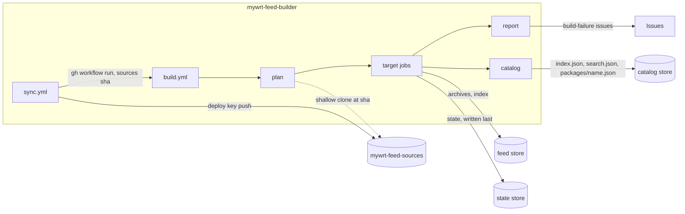

# mywrt-feed-builder

[English](README.md) | **中文**

维护 `mywrt` OpenWrt 软件包 feed：

1. **同步**：抓取 `sources.toml` 中列出的上游软件包，应用 `local-patches/`
   中的补丁（详见 [local-patches/README_ZH.md](local-patches/README_ZH.md)），
   再把结果按 `<category>/<name>/` 推送到
   [mywrt-feed-sources](https://github.com/MyWRT/mywrt-feed-sources)。该仓库可以
   直接当作 `src-git` feed 使用。
2. **构建**：只编译源码发生变化的软件包（在 ImmortalWrt SDK 容器里），并发布到
   feed 存储的 `<feed store>/packages-<version>/<arch>/mywrt/` 下。

来自官方 feed 的依赖会在需要时编译，但从不发布；设备通过 ImmortalWrt feed 获取它们。



## 文件一览

| 路径 | 用途 |
|---|---|
| `sources.toml` | 上游仓库：每个软件包一个 `[[package]]`（`name`、`category`、`repo`，可选 `branch`、`path`） |
| `local-patches/feed/<name>/*.patch` | 同步期间应用到该软件包目录 |
| `local-patches/source/<name>/*.patch` | 复制到 `<name>/patches/`，由 OpenWrt 应用到上游源码 |
| `targets.toml` | 版本、架构、额外的 `.config`、存储、保留策略、`epoch` |
| `templates/sources-README.md`、`templates/sources-README_ZH.md` | sources 仓库的 README 模板（中/英，含 `${updated}` 占位符） |
| `scripts/sync_sources.py` | 同步步骤 |
| `scripts/feedctl.py` | 构建计划、feed 状态、保留策略、垃圾回收、catalog |
| `docs/catalog.md` | 已发布元数据 catalog 的格式（Web 前端的契约） |
| `scripts/failure_issues.py` | 创建、评论和关闭 `build-failure` issue |
| `scripts/sdk-run.sh`、`sdk/entry.sh` | 运行 SDK 容器（`build` 或 `index`） |

## 同步

`sync.yml` 每天运行一次，也支持手动触发，以及在 `sources.toml`、`local-patches/` 或
`templates/` 有变更的推送时运行。只要有任何一次克隆失败、某个软件包缺少
`Makefile`、名称发生冲突，或者某个补丁无法应用（例如上游已经包含了该修复：删掉补丁即可），
它就会中止，不会改动 sources 仓库。当生成的目录树出现差异时，它会提交
`Sync: <changed packages>`；如果有软件包发生变化，还会为这次提交启动 `build.yml`。

README（英文版 `README.md` 与中文版 `README_ZH.md`）由 `templates/sources-README.md` 和
`templates/sources-README_ZH.md` 经
[`string.Template`](https://docs.python.org/3/library/string.html#template-strings)
渲染而来（字面量 `$` 写作 `$$`）。`${updated}` 是软件包最后一次变更的时间（UTC，
形如 `2026-10-16 03:15 UTC`）。同步提交以这个时间作为 author date，之后的同步会把它读回来，
因此只改模板会沿用上一次的时间，而没有变化的同步不会产生任何提交。

## 构建

当 sync 推送了提交、`targets.toml` 发生变化，或手动触发时，`build.yml` 会运行
（`packages` 强制重建指定软件包，`full_rebuild` 则全部重建）。没有定时构建：状态会与源码
比对，所以任何一次运行都会补上先前被中断的运行遗漏的内容。运行变红表示基础设施出了问题
（feed 没有发布或只发布了一部分），重新运行即可。软件包构建失败不会让运行失败：feed 照常
发布，该软件包会得到一条警告注解和一个 `Build failure: <name>` issue。

每个 target 有一个状态文件 `<state store>/packages-<version>/<arch>.json`，逐包记录
上一次构建所用的指纹和构建结果。指纹把 `<category>/<name>/`（忽略顶层的 `README*`、
`LICENSE*`、`LICENSES/`、`.gitignore` 和 `.github/`）与 `targets.toml` 中的构建配方
一起做哈希。

| 结果 | feed | 下次运行 |
|---|---|---|
| built（构建成功）| 新归档被索引 | 指纹变化时重建 |
| unsupported（架构被 `DEPENDS` 排除）| 旧归档从索引中移除 | 指纹变化时重建 |
| build failed（编译还会用 `-j1 V=s` 重试一次）| 保留上一次的构建结果；创建 issue | **不重试**，直到指纹变化或有人手动指定该软件包 |
| download failed（每次运行尝试 3 次）| 保留上一次的构建结果 | 重试；连续 3 次运行都失败后按构建失败处理 |

`report` 作业会为每个构建失败的软件包创建一个 `Build failure: <name>` issue，其中列出失败
的 target、源码提交和日志尾部；再次失败时在该 issue 上追加评论，一旦没有任何 target
状态还把该软件包标记为失败，就关闭它。完整日志以 `logs-<version>-<arch>` artifact 的形式保留
30 天。

## 保留策略

索引只列出每个软件包的最新一次构建。只要旧归档在最近 `retention.days`（30）天内曾是当前
版本，它就保持可下载；同时每个已发布软件包最新的 `retention.min_versions`（2）个归档
始终保留。已下架软件包的归档保留 `retention.days` 天。每次发布之后，feed 目录中既不被状态
也不被索引引用的文件都会被删除，所以过期归档会在该 target 下一次构建时被清掉。

## 存储

所有存储都是 `targets.toml` 中 `[storage]` 里配置的 rclone 路径，使用 `RCLONE_CONFIG`
secret 里的 remote，因此任何 rclone 后端都可以（R2、S3、Dropbox……）。

| 存储 | 存放内容 | 要求 |
|---|---|---|
| feed（`storage.feed`）| 归档和已签名索引 | 容量要大；通过 HTTP(S) 直接提供给设备，**不能有重定向**：apk 和 opkg 都不跟随重定向，所以 Dropbox 前面需要一个能流式转发文件的代理 |
| state（`storage.state`）| 每个 target 一个小 JSON | 持久保存；每次运行都会读取 |
| catalog（`storage.catalog`）| 供 Web 前端使用的软件包元数据（[格式](docs/catalog.md)）| 每次运行都由 `catalog` 作业从全部状态重新生成，并用 `rclone sync` 整体替换，因此它不能包含 feed 或 state 存储，也不能位于 state 存储内部 |

一次发布会先把归档、再把索引写入 feed 存储，最后把状态写入 state 存储。如果在状态写入之前
中断，下次运行会重建这些软件包并清掉残留文件。

迁移 feed 存储：在切换 `storage.feed` 之前，先把现有的 `packages-*` 目录树复制到新位置
（`rclone copy`）。索引里列出但 feed 存储中缺失的归档会在下一次运行被移出索引，并在再下一次
运行被重建。

## 部署

### 配置参考

本仓库的 secrets：

| Secret | 内容 |
|---|---|
| `SOURCES_DEPLOY_KEY` | 对 sources 仓库有**写权限**的 deploy key 的私钥部分 |
| `RCLONE_CONFIG` | 用 base64 编码的 `rclone.conf`（`base64 -w0 rclone.conf`），定义了 `[storage]` 中引用的每一个 remote |
| `KEY_BUILD` | usign 私钥，用于签名 opkg 索引（24.10） |
| `PRIVATE_KEY` | SEC1 PEM 格式的 EC P-256 私钥，用于签名 apk 索引（25.12） |

变量（全部可选）：

| 变量 | 默认值 | 用途 |
|---|---|---|
| `SOURCES_REPO` | `MyWRT/mywrt-feed-sources` | sources 仓库（`owner/name`） |
| `FEED_STORE`、`STATE_STORE`、`CATALOG_STORE` | `targets.toml` 中的 `[storage]` | 覆盖存储位置，例如测试时用的临时前缀 |

工作流声明了自己需要的 `GITHUB_TOKEN` 权限（`actions: write` 用于启动构建，`issues: write`
用于失败 issue）。如果组织策略把 token 限制为只读，这两者都会失效。

### 首次部署

推送本仓库就会启动 `Sync sources` 和 `Build feed`，所以它们要读取的一切都得在首次推送之前
准备好。

1. **签名密钥。** 复用已有密钥，或者新建一对；公钥部分要放到设备上
   （`/etc/opkg/keys/`、`/etc/apk/keys/`）：
   ```sh
   usign -G -s key-build -p key-build.pub -c 'mywrt feed'                 # opkg
   openssl ecparam -name prime256v1 -genkey -noout -out private-key.pem   # apk, SEC1
   openssl ec -in private-key.pem -pubout -out public-key.pem
   ```
2. **rclone。** 用 `rclone config` 创建 remote（R2 的话，就是 provider 为 `Cloudflare`
   的 `s3` remote，外加一个只允许访问所用 bucket 的 API token），然后编码该文件：
   `base64 -w0 ~/.config/rclone/rclone.conf > rclone.base64`。
3. **sources 仓库。** 它需要一个可检出的提交；首次同步会替换掉它的全部内容：
   ```sh
   gh repo create MyWRT/mywrt-feed-sources --public --add-readme
   ```
4. **本仓库，但暂时先不要推送：**
   ```sh
   gh repo create MyWRT/mywrt-feed-builder --public
   ```
5. **Deploy key：**
   ```sh
   ssh-keygen -t ed25519 -N '' -C mywrt-feed-builder -f sources_deploy
   gh repo deploy-key add sources_deploy.pub -R MyWRT/mywrt-feed-sources --allow-write --title mywrt-feed-builder
   gh secret set SOURCES_DEPLOY_KEY -R MyWRT/mywrt-feed-builder < sources_deploy
   rm sources_deploy sources_deploy.pub
   ```
6. **Secrets：**
   ```sh
   gh secret set RCLONE_CONFIG -R MyWRT/mywrt-feed-builder < rclone.base64
   gh secret set KEY_BUILD     -R MyWRT/mywrt-feed-builder < key-build
   gh secret set PRIVATE_KEY   -R MyWRT/mywrt-feed-builder < private-key.pem
   ```
   然后删掉不再需要的本地副本；这些东西都不该留在仓库里。
7. **临时存储。** 发布操作会删除目标 feed 目录里所有未被引用的文件，所以最初的几次运行
   要写到单独的前缀下：
   ```sh
   gh variable set FEED_STORE    -R MyWRT/mywrt-feed-builder -b 'r2:mywrt-dist/next'
   gh variable set STATE_STORE   -R MyWRT/mywrt-feed-builder -b 'r2:mywrt-dist/next/.feed-state'
   gh variable set CATALOG_STORE -R MyWRT/mywrt-feed-builder -b 'r2:mywrt-dist/next/.feed-catalog'
   ```
8. **推送：**
   ```sh
   git remote add origin git@github.com:MyWRT/mywrt-feed-builder.git
   git push -u origin main
   ```
   `Sync sources` 会填充 sources 仓库，并为该提交启动 `Build feed`。推送本身触发的那次
   `Build feed` 可能还找不到任何软件包，只会发布一个空的 catalog。
9. **检查首次构建**（每个 target 上的每个软件包）：
   - 所有 target 作业都是绿色；运行摘要列出已构建的软件包；
   - 每个 `<feed store>/packages-<version>/<arch>/mywrt/` 里都有归档，以及 `Packages`
     和 `Packages.sig`（24.10）或 `packages.adb`（25.12）；
   - `<catalog store>/index.json`、`search.json` 和 `packages/*.json` 都存在，且 25.12 的
     详情文档带有 `installed_size` / `provides` 值；
   - 把测试设备指向临时 feed，能验证签名并成功安装软件包。
10. **检查增量。** 不带任何输入手动运行一次 `Build feed`：计划里没有任何待构建项，只有
    `catalog` 作业有实际工作。
11. **正式上线。** 删除那三个变量（或把 `[storage]` 指向最终位置），再用 `full_rebuild`
    运行一次 `Build feed`。

### 从 immortalwrt-packages-builder 迁移

在第 11 步之前，先禁用旧仓库的工作流。之后每个 target 的首次发布会删掉旧构建器遗留在
`mywrt/` 里的归档。随后删除它一并发布的那些子 feed —— 设备改从 ImmortalWrt feed 获取：

```sh
for v in 24.10 25.12; do
  for a in x86_64 aarch64_generic arm_cortex-a7_neon-vfpv4; do
    for f in base luci packages routing telephony; do
      rclone purge "r2:mywrt-dist/packages-$v/$a/$f"
    done
  done
done
```

### 在别处运行

如果换成别的 owner 或仓库名，请设置 `SOURCES_REPO`，调整 `[storage]`，并更新
`templates/sources-README.md` 里的链接和下载 URL。

## 在本地运行各个步骤

```sh
python3 scripts/sync_sources.py --dest ../mywrt-feed-sources

SDK_IMAGE=immortalwrt/sdk VERSION=24.10 ARCH=x86_64 FEED_NAME=mywrt \
SOURCES_DIR=$PWD/../mywrt-feed-sources OUT_DIR=$PWD/.work/build \
PACKAGES='luci-theme-glass' EXTRA_CONFIG='# CONFIG_RUBY_ENABLE_YJIT is not set' \
SDK_DOCKER_ARGS='--userns=keep-id:uid=1000,gid=1000' \
scripts/sdk-run.sh build
```

只有在用 rootless podman 时才需要 `SDK_DOCKER_ARGS`。本仓库要求 Python 3.11+
（`tomllib`）。

## 许可证

本仓库内容采用 [MIT](LICENSE)。同步进 sources 仓库的软件包以及由它们构建出的归档，
保留各自的上游许可证。
